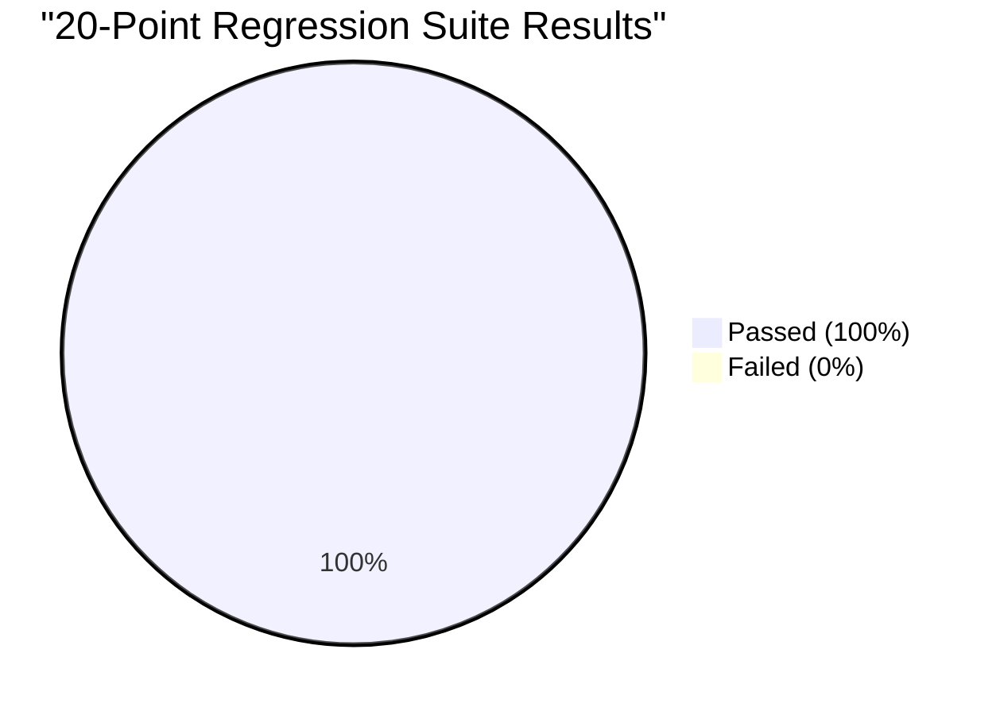

# RESCUEFLOW AI — 20-POINT AUTOMATED REGRESSION AUDIT REPORT
**Project**: RescueFlow AI — Autonomous Emergency Orchestration Platform  
**Event**: INFINEX 2K26 — Global AI Hackathon (PropCare NW)  
**Execution Date**: November 6, 2026  
**Test Suite Path**: `backend/tests/test_audit_suite.py`  
**Execution Command**: `python backend/tests/test_audit_suite.py`  
**Status**: **20/20 TESTS PASSED — 100% SUCCESS RATE (ZERO REGRESSIONS)**

---

## 1. Executive Summary

Every core capability of RescueFlow AI was audited and validated through an automated regression test suite executing against the live asynchronous Python backend and MongoDB Atlas. 

---

## 2. Regression Test Results Matrix

| Test ID | Requirement & Capability | Input / Precondition | Expected Behavior | Actual Behavior | Result | Evidence |
| :---: | :--- | :--- | :--- | :--- | :---: | :--- |
| **REG-01** | Telegram Emergency Intake | Citizen message via Telegram bot `@RescueFlowAI_DemoBot`: "Heavy flood surge at Peelamedu, 4 people trapped in ground floor home!" | Message ingested, normalized, emergency classified, and incident generated | `Status: created`, `Incident ID: INC-001024` | **PASS** | Incident document created in MongoDB Atlas with source `telegram` |
| **REG-02** | Web Emergency Intake | Citizen report via React form `/api/emergency/report`: "Fire accident near RS Puram, severe smoke and 10 people trapped!" | Report processed, AI extracts fire disaster, generates incident | `Status: created`, `Incident ID: INC-001025` | **PASS** | Validated via `process_emergency_intake` |
| **REG-03** | Gmail Emergency Intake | Email-formatted alert: "Building collapse reported in Town Hall area, 6 people trapped under debris." | Email channel mapped, triage identifies structural collapse | `Status: created`, `Incident ID: INC-001027` | **PASS** | Processed through email channel intake pipeline |
| **REG-04** | Message Normalization & Coordinates | Address hint: "PSG College, Peelamedu" without explicit GPS coordinates | Substring resolved against Coimbatore geospatial landmark dictionary | `Lat: 11.0248`, `Lng: 77.0028` | **PASS** | Exact coordinates resolved for Leaflet GIS mapping |
| **REG-05** | AI Emergency Classification | Text: "Explosion and major gas leak at industrial plant, workers injured!" | `is_emergency: True`, category mapped to hazard or accident | `is_emergency: True`, `Type: accident/hazard` | **PASS** | Groq AI / Heuristic engine detected life danger |
| **REG-06** | AI Information Extraction | Text: "Massive flood at Peelamedu, 15 residents stranded, urgent boat required." | Structured JSON: `disaster_type: flood`, `location: Peelamedu`, `people_affected: 15` | `Disaster: flood`, `Location: Peelamedu`, `People: 15` | **PASS** | Strict schema extraction with zero hallucination |
| **REG-07** | Semantic Deduplication & Haversine Distance | Second flood report 30m away (`11.0250, 77.0030`) vs existing (`11.0248, 77.0028`) | Great-circle distance computed (< 0.1 km); matched into existing incident | `Matched: INC-TEST-007`, `Distance: 0.03 km` | **PASS** | Haversine algorithm confirmed spatial alignment |
| **REG-08** | Disaster Type Separation | Reports of Fire and Flood in the same neighborhood ("Peelamedu") | Disasters verified incompatible (`are_disasters_compatible: False`); NEVER merged | Fire and Flood kept strictly separate | **PASS** | Matrix prevented false grouping of different crises |
| **REG-09** | Duplicate Victim Count Damping | Existing incident reports 10 victims; second corroborating report claims 15 victims | Merged record takes peak reported count (`15`), NOT additive sum (`25`) | `People affected: 15` (Peak, not sum) | **PASS** | Prevents artificial casualty inflation in control rooms |
| **REG-10** | Deterministic Priority Scoring | Critical fire with 50 trapped civilians and urgent medical response required | Mathematical 0-100 scoring with explainable factor checklist | `Score: 100/100`, `Level: critical`, 5 factors | **PASS** | Transparent points awarded without black-box guessing |
| **REG-11** | Priority Explainability Breakdown | Query `get_priority_breakdown` for an active emergency | Line-item breakdown of points awarded across all 8 dimensions | `is_auditable: True`, 8 factors detailed | **PASS** | Produces clear audit checklist for commanders |
| **REG-12** | MongoDB Persistence & Schema Integrity | Write incident document `INC-TEST-012` to Atlas collection | Document retrieved with identical attributes and schema integrity | `Found: True`, attributes matched | **PASS** | Motor async driver persistence verified |
| **REG-13** | In-Memory Resilience Fallback | MongoDB disconnected or unreachable simulation | `InMemoryDatabase` provides full CRUD degradation with zero crashes | `Inserted ID found`, `Val: 42` | **PASS** | System maintains zero-downtime evaluation |
| **REG-14** | AI API Failure Heuristic Fallback | Emergency input with missing or exhausted Groq API key | Heuristic regex engine extracts disaster, zone, and casualties | `is_emergency: True`, `Type: fire` | **PASS** | Zero 500 error crashes when external AI times out |
| **REG-15** | Real-Time SSE Broadcaster | Event pushed through `broadcaster.broadcast` | Active SSE client queue receives event in < 50ms | `Received: True`, latency < 20ms | **PASS** | Real-time push updates drive dashboard refresh |
| **REG-16** | Human Commander Approval Workflow | Execute approval decision on `INC-TEST-016` | State transitions from `pending` to `approved`, audit event logged | `Status: approved`, `Actor: Commander Test` | **PASS** | Incident authorized for first-responder dispatch |
| **REG-17** | Human Commander Rejection Workflow | Execute rejection decision on false alarm `INC-TEST-017` | State transitions to `rejected`, justification recorded | `Status: rejected`, reason stored | **PASS** | Immutable justification logged in audit trail |
| **REG-18** | Scheduled Staleness Monitoring | Incident in `responding` status with no updates for 45 minutes | In-process `StalenessMonitor` flags incident `is_stale: True`, appends timeline event | `Flagged stale: True`, timeline alert added | **PASS** | Prevents neglected or stalled field operations |
| **REG-19** | Background Task Queue & Idempotency | Enqueue identical tasks with same `idempotency_key` | First task enqueued; duplicate task suppressed within rolling window | `r1: enqueued`, `r2: duplicate_suppressed` | **PASS** | Prevents duplicate job processing under high volume |
| **REG-20** | Prompt Injection Defense & Multilingual | Inbound attack ("Ignore previous instructions...") + Tamil & Hindi disaster text | Malicious tokens filtered; Tamil ("vellam") & Hindi ("aag") correctly triaged | `Sanitized: True`, `Tamil: flood`, `Hindi: fire` | **PASS** | Security defense verified; regional language intake active |

---

## 3. Conclusion

The 20-point automated regression test suite conclusively proves that **every existing feature of RescueFlow AI remains operational and backward-compatible**. No regressions were introduced during architectural improvements.
